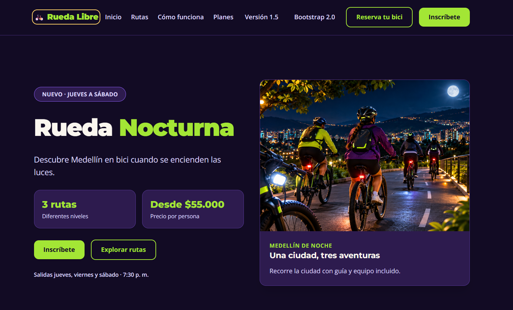
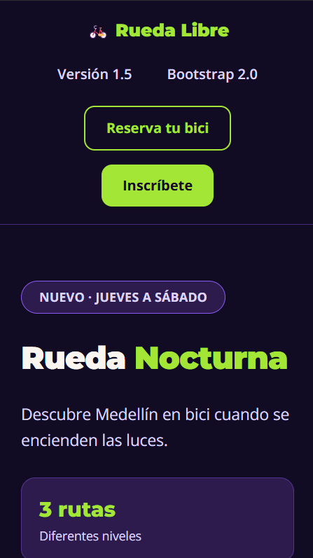
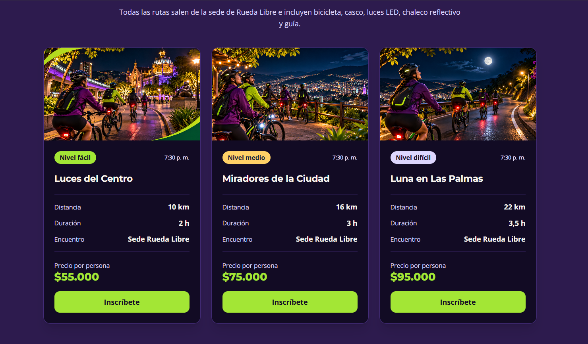

<div align="center">

# 🚲 RUEDA LIBRE

### Explora Medellín sobre dos ruedas. Descubre la ciudad bajo una nueva luz.

**Un ecosistema web para alquiler de bicicletas, recorridos guiados y experiencias nocturnas.**

<br>


<br>

[**🌐 Sitio original**](https://dahiana21.github.io/rueda-libre/) · [**🚴 Rueda Libre 2.0**](https://dahiana21.github.io/rueda-libre/bootstrap/index.html) · [**🌙 Rueda Nocturna**](https://dahiana21.github.io/rueda-libre/nocturna/index.html)

**Proyecto académico · Frontend · Riwi · 2026**

</div>

---

## ✨ El proyecto

**Rueda Libre** es una propuesta web de alquiler de bicicletas y recorridos guiados por **Medellín, Colombia**. Su objetivo es presentar de forma clara las bicicletas disponibles, las tarifas, las rutas y el proceso de reserva, con una experiencia accesible y adaptable a diferentes dispositivos.

El proyecto evolucionó desde un sitio construido con **HTML y CSS personalizados** hasta una versión **Bootstrap 5** y una landing temática, **Rueda Nocturna**, desarrollada con **Tailwind CSS v4**.

> 🌙 **Rueda Nocturna:** una experiencia pensada para descubrir Medellín cuando se encienden las luces, con rutas guiadas, planes de participación e inscripción mediante un formulario validado.

## 🔗 Explora el ecosistema

| Experiencia | ¿Qué encontrarás? | Acceso |
|:--|:--|:--|
| **Rueda Libre · Sitio original** | Información del negocio, servicios, tarifas y reservas. | [Visitar sitio](https://dahiana21.github.io/rueda-libre/) |
| **Rueda Libre 2.0 · Bootstrap** | Catálogo de bicicletas, rutas, promociones, formularios y navegación adaptable. | [Explorar versión 2.0](https://dahiana21.github.io/rueda-libre/bootstrap/index.html) |
| **Rueda Nocturna · Tailwind** | Tres recorridos nocturnos, planes, inscripción y diseño claro/oscuro. | [Descubrir la campaña](https://dahiana21.github.io/rueda-libre/nocturna/index.html) |
| **Código fuente** | Organización, evolución y archivos del proyecto. | [Ver repositorio](https://github.com/Dahiana21/rueda-libre) |


## 📸 Una experiencia para cada pantalla

### 💻 Vista de escritorio



### 📱 Vista de celular



### 🌙 Modo oscuro




---

## 🧭 ¿Qué puedes hacer en Rueda Libre?

### 🚴 Sitio Bootstrap 2.0

- Explorar una **flota de siete modelos de bicicletas** y consultar información y tarifas.
- Conocer **rutas guiadas**, beneficios y promociones.
- Navegar entre **Inicio, Tarifas y Reservas** con una barra adaptable a móviles.
- Consultar un **carrusel de promociones**, incluida la campaña Rueda Nocturna.
- Completar un **formulario con validaciones HTML5 y retroalimentación visual**.
- Leer las **políticas de alquiler** desde un modal, sin abandonar la página.
- Acceder a la landing nocturna desde el menú y la promoción integrada.

### 🌙 Landing Rueda Nocturna

- Descubrir las rutas **Luces del Centro**, **Miradores de la Ciudad** y **Luna en Las Palmas**.
- Comparar **tres planes de participación**:

| Plan | Tarifa indicada | Ideal para |
|:--|--:|:--|
| 🚲 **Individual** | **$55.000 por persona** | Vivir la experiencia a tu ritmo. |
| 💜 **Pareja** | **$99.000 por dos personas** | Compartir el recorrido; identificado como *Más elegido*. |
| 👥 **Grupo** | **$45.000 por persona** | Recorrer en compañía de 4 a 8 participantes. |

- Conocer el proceso de participación en la sección **¿Cómo funciona?**.
- Completar un formulario de inscripción con validaciones de nombre, correo, celular y demás datos solicitados.
- Consultar una interfaz **mobile-first**, con **modo claro y oscuro** según las preferencias del dispositivo.
- Volver al sitio Bootstrap para conocer las opciones generales de reserva.

> **Alcance del prototipo:** el formulario permite introducir y validar información, pero **no envía ni almacena reservas o inscripciones en un servidor**. La gestión de reservas y pagos en línea queda planteada como una mejora futura.

## 🛠️ Tecnologías y herramientas

| Tecnología | Uso en el proyecto |
|:--|:--|
| **HTML5** | Estructura semántica, formularios y contenido accesible. |
| **CSS3** | Identidad visual, Box Model, Flexbox, Grid y estilos personalizados. |
| **Bootstrap 5** | Navbar, grilla responsive, cards, carrusel, alertas, modal y formularios. |
| **Tailwind CSS v4** | Diseño utility-first, breakpoints, tema propio y modo oscuro. |
| **JavaScript** | Interacciones de interfaz y validación del lado del cliente. |
| **Node.js + npm** | Gestión de dependencias y ejecución de Tailwind CLI. |
| **Git + GitHub** | Control de versiones y repositorio de código. |
| **GitHub Pages** | Publicación web estática. |
| **Chrome DevTools + W3C** | Inspección del diseño y revisión de HTML y accesibilidad. |

## 🎨 Identidad visual

La identidad original conecta las distintas versiones; la campaña nocturna añade una paleta complementaria.

| Color | Código | Uso principal |
|:--|:--|:--|
| 🟢 Verde Ruta | `#1E7A4F` | Acciones y enlaces de la marca. |
| 🟠 Naranja Pedal | `#F39A2B` | Destacados y acciones secundarias. |
| 🔵 Azul Noche | `#14213D` | Encabezados y tipografía principal. |
| ⚪ Crema | `#FAF6EF` | Fondos y textos sobre superficies oscuras. |
| ⚫ Gris Asfalto | `#5B6470` | Información secundaria. |
| 🟣 Morado Noche | `#120B24` | Fondo del tema nocturno. |
| 💜 Morado Profundo | `#2D1B4E` | Tarjetas y paneles nocturnos. |
| 💚 Verde Neón | `#A3E635` | Botones y acentos de la campaña. |
| 🪻 Lavanda | `#DDD6FE` | Información secundaria sobre fondos oscuros. |

**Tipografías:** `Montserrat` para títulos y `Open Sans` para contenidos e interfaces.

## ⚖️ Bootstrap vs. Tailwind CSS — Decisión técnica del MiniReto 8

| Criterio | Bootstrap 5 | Tailwind CSS v4 |
|:--|:--|:--|
| **Punto fuerte** | Componentes prediseñados e implementación rápida. | Personalización visual y control detallado del diseño. |
| **Experiencia de desarrollo** | Navbar, carrusel y modal disponibles con el framework. | Composición de componentes mediante utilidades. |
| **Diseño responsive** | Sistema de grilla y breakpoints. | Enfoque mobile-first con prefijos como `sm:`, `md:` y `lg:`. |
| **Identidad de marca** | Requiere adaptar variables y algunos estilos propios. | Permite definir colores y tipografías mediante `@theme`. |
| **Reutilización** | Componentes y clases del framework. | Clases propias como `btn-principal`, `btn-secundario` y `btn-contorno` mediante `@apply`. |
| **Mejor aplicación aquí** | Sitio general con componentes interactivos. | Landing temática con diseño visual personalizado y modo oscuro. |

### 🏆 Recomendación: Tailwind CSS para la evolución visual

Después de implementar ambos enfoques, **recomiendo Tailwind CSS para futuras ampliaciones de la experiencia visual de Rueda Libre**. Su sistema de utilidades permite adaptar la interfaz a una identidad particular, mantener coherencia entre componentes y construir variantes claras y oscuras.

**Bootstrap sigue siendo una excelente elección** para secciones que requieren componentes listos para usar, como el carrusel y los modales. La recomendación se basa principalmente en la **flexibilidad y la experiencia de desarrollo**, no en afirmar que uno de los frameworks sea universalmente más rápido.

**Medición registrada en la bitácora:** el archivo `nocturna/src/output.css` generado con minificación tenía **29.809 bytes (29,11 KiB)**. Los recursos de Bootstrap fueron medidos mediante la pestaña Network de Chrome DevTools. Como se trata de mediciones de recursos distintos, no se utilizan para concluir por sí solas cuál versión carga más rápido.

## 🧪 Calidad, accesibilidad y pruebas

Durante la construcción se trabajó con:

- Estructura semántica mediante `header`, `nav`, `main`, `section`, `article` y `footer`.
- Imágenes con atributos `alt`, formularios con `label`, grupos `fieldset`/`legend` y controles obligatorios.
- Navegación por teclado y estados `hover`, `focus` y `focus-visible`.
- Diseño responsive con **Flexbox, CSS Grid y Box Model**.
- Validación del HTML mediante **W3C Nu HTML Checker** y corrección de rutas, autocompletado y atributos ARIA.
- Pruebas de la landing registradas a **375 px, 768 px y 1440 px**.
- Inspección de las tarjetas de planes en DevTools, con **24 px de padding** y alturas exteriores equivalentes.
- Comprobaciones de contraste para combinaciones de colores de la marca y la campaña nocturna.

## 📁 Organización del repositorio

```text
rueda-libre/
├── index.html                      # Sitio original
├── css/                            # Estilos de la versión original
├── paginas/                        # Tarifas y reservas originales
├── bootstrap/
│   ├── index.html                  # Rueda Libre 2.0
│   ├── paginas/
│   │   ├── tarifas.html
│   │   └── reservas.html
│   └── css/
│       └── styles.css
├── nocturna/
│   ├── index.html                  # Landing Rueda Nocturna
│   ├── prototipo.html              # Primer prototipo
│   ├── componentes.html            # Kit visual
│   ├── src/
│   │   ├── input.css               # Fuente de Tailwind
│   │   └── output.css              # CSS compilado y minificado
│   └── package.json
├── img/                             # Recursos visuales
├── capturas/
│   ├── escritorio.png
│   ├── celular.png
│   └── modo-oscuro.png
└── README.md
```

## 🚀 Ejecutar el proyecto localmente

**1. Clona el repositorio:**

```bash
git clone https://github.com/Dahiana21/rueda-libre.git
cd rueda-libre
```

**2. Abre el proyecto en VS Code.** Puedes utilizar una extensión como Live Server para abrir cualquiera de estas páginas:

- `index.html` — sitio original.
- `bootstrap/index.html` — sitio Bootstrap 2.0.
- `nocturna/index.html` — campaña Rueda Nocturna.

**3. Si vas a modificar los estilos de Tailwind**, abre una terminal en `nocturna/` y ejecuta:

```bash
npm install
npm run dev
```

Para generar la hoja final optimizada:

```bash
npm run build
```

El archivo `nocturna/src/output.css` debe conservarse en el repositorio porque GitHub Pages sirve archivos estáticos y no ejecuta el compilador de Tailwind durante la visita.

## 📚 Evolución y aprendizajes

| Etapa | Lo que construí | Lo que aprendí |
|:--|:--|:--|
| **Versión original** | Inicio, tarifas, reservas e identidad visual. | HTML semántico, CSS, validaciones, accesibilidad y publicación. |
| **Bootstrap 2.0** | Navbar, catálogo, carrusel, formularios y componentes de marca. | Grilla, utilidades, personalización y diseño responsive. |
| **Rueda Nocturna** | Landing, kit visual, rutas, planes, formulario y modo oscuro. | Tailwind CLI, `@theme`, `@apply`, mobile-first y optimización CSS. |
| **Integración final** | Enlaces entre productos, validaciones W3C y documentación. | Rutas relativas, DevTools, GitHub Pages y preparación de una entrega. |

### 💡 Lo más importante que aprendí

Este proyecto me enseñó que una página no está terminada solo porque se vea bien: también debe ser **usable, accesible, comprensible, adaptable y fácil de mantener**. La comparación entre frameworks me permitió tomar decisiones técnicas con criterios reales, y la integración de las versiones me mostró la importancia de verificar cada enlace antes de publicar.

## 🔮 Próximos pasos

- Integrar un backend para **guardar y gestionar reservas e inscripciones**.
- Consultar la **disponibilidad de bicicletas** en tiempo real.
- Incorporar **pagos en línea** y confirmaciones automáticas.
- Adaptar la cantidad de acompañantes según el plan seleccionado.
- Ampliar las pruebas automatizadas de accesibilidad y funcionamiento.

---

<div align="center">

### 💚 Pedalea, explora y descubre nuevas rutas.

**Desarrollado por Dahiana21**  
**Proyecto académico de Frontend · Riwi · Medellín, Colombia · 2026**

[**⬆ Volver al inicio**](#-rueda-libre)

</div>
